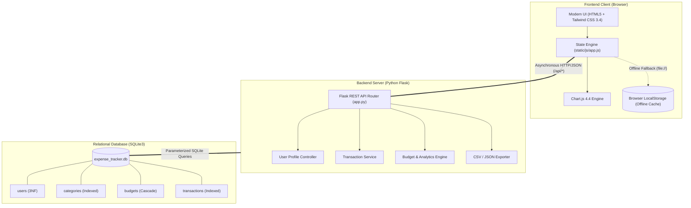
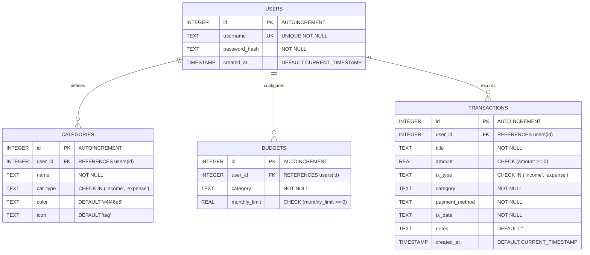

# FinTrack Pro — Smart Personal & Semester Expense Tracker

<div align="center">


<p align="center">
  <strong>A full-stack, dual-architecture expense tracking platform engineered for students, scholars, and individuals.</strong><br>
  Enforces category-level monthly budget caps, delivers rich multi-chart visual analytics, provides 1-click quick presets, and generates certified financial statements.
</p>

[Key Features](#-key-features) •
[UI Preview](#-ui--dashboard-preview) •
[System Architecture](#-system-architecture) •
[Database Schema (3NF)](#-database-schema--er-diagram) •
[REST API Reference](#-rest-api-documentation) •
[Quick Start](#-installation--quick-start) •
[Viva & Interview Prep](#-viva-voce--interview-qa) •
[Presentation Script](#-5-minute-viva--demo-walkthrough-script)

</div>

---

## 📋 Table of Contents
1. [Project Overview](#-project-overview)
2. [Why FinTrack Pro? (Feature Matrix)](#-why-fintrack-pro-feature-comparison)
3. [UI & Dashboard Preview](#-ui--dashboard-preview)
4. [System Architecture](#-system-architecture)
5. [Key Features](#-key-features)
6. [Project Directory Structure](#-project-directory-structure)
7. [Database Schema & ER Diagram](#-database-schema--er-diagram)
8. [REST API Documentation](#-rest-api-documentation)
9. [Installation & Quick Start](#-installation--quick-start)
10. [5-Minute Viva & Demo Walkthrough Script](#-5-minute-viva--demo-walkthrough-script)
11. [Viva Voce & Technical Q&A](#-viva-voce--interview-qa)
12. [Future Engineering Roadmap](#-future-engineering-roadmap)
13. [Troubleshooting & FAQs](#-troubleshooting--faqs)
14. [License](#-license)

---

## 🌟 Project Overview

**FinTrack Pro** is a modern, responsive personal finance and semester ledger management application. It bridges the gap between static spreadsheet formulas and intrusive commercial finance apps by delivering:

- **Dual-Mode Persistence**: Automatically binds to a **Python Flask + SQLite** REST API backend when hosted on a server, while seamlessly falling back to browser **`localStorage`** in offline or zero-install mode.
- **Strict Budget Discipline**: Custom monthly expenditure limits per category with real-time visual progress gauges and dynamic threshold triggers (**80% Warning**, **100% Exceeded**).
- **Deep Visual Intelligence**: 4 interactive charts powered by **Chart.js 4.4** visualizing category breakdowns, daily spending velocity, budget versus actual comparisons, and payment channel distributions.
- **Data Portability**: RFC-4180 compliant CSV exports, full database snapshot JSON backup/restore, and CSS `@media print` formatted academic financial statements.

---

## ⚖️ Why FinTrack Pro? (Feature Comparison)

| Feature | Basic Spreadsheets (Excel/Sheets) | Commercial Apps (Mint / Walnut) | **FinTrack Pro (v2.0)** |
|---|---|---|---|
| **Privacy & Security** | Manual, unencrypted files | Third-party cloud tracking & bank scraping | **100% Private local SQLite relational DB** |
| **Offline Capability** | Manual formulas | Requires active internet connection | **Full Dual-Mode (Online REST + Offline Cache)** |
| **Setup Overhead** | Complex cell formulas & broken links | Account creation & intrusive ads | **Zero Installation (Double-click or 1-command Flask)** |
| **Budget Enforcement** | Static conditional formatting | Generic notifications | **Dynamic visual gauges & automated warning banners** |
| **Visual Analytics** | Manual chart creation | Locked behind premium paywalls | **4 interactive Chart.js visualizations built-in** |
| **Academic Reporting** | Manual copy-pasting | Non-standard reports | **Certified `@media print` semester statement** |

---

## 🖥️ UI & Dashboard Preview

```text
┌────────────────────────────────────────────────────────────────────────────────────────┐
│  ₹  FinTrack Pro      [🟢 SQLite API Synced]    [Billing Month: 2026-10] [₹ INR]  👤 Aarav   │
├────────────────────────────────────────────────────────────────────────────────────────┤
│  [ Dashboard ]  [ Transactions ]  [ Budgets & Caps ]  [ Categories ]  [ Analytics ]    │
├────────────────────────────────────────────────────────────────────────────────────────┤
│  ⚡ Quick Add:  [🍕 Lunch ₹120]  [☕ Coffee ₹40]  [🚌 Transit ₹50]  [📚 Notes ₹250]      │
├────────────────────────────────────────────────────────────────────────────────────────┤
│  ┌────────────────┐ ┌────────────────┐ ┌────────────────┐ ┌────────────────────────┐  │
│  │ Total Inflow   │ │ Total Outflow  │ │ Net Savings    │ │ Budget Cap Used        │  │
│  │ ₹25,000.00     │ │ ₹17,599.00     │ │ ₹7,401.00      │ │ 76%                    │  │
│  │ 1 deposit      │ │ Avg ₹586/day   │ │ Savings: 30%   │ │ [████████████░░] Safe  │  │
│  └────────────────┘ └────────────────┘ └────────────────┘ └────────────────────────┘  │
├────────────────────────────────────────────────────────────────────────────────────────┤
│  ┌───────────────────────────────┐  ┌───────────────────────────────────────────────┐  │
│  │ 🍩 Expenses by Category       │  │ 📈 Daily Spending Velocity                    │  │
│  │ • Food & Dining (22%)         │  │    ^                                          │  │
│  │ • Housing & Rent (43%)        │  │   / \   _                                     │  │
│  │ • Books & Education (17%)     │  │ _/   \_/ \___  (Smooth curved area line)      │  │
│  └───────────────────────────────┘  └───────────────────────────────────────────────┘  │
│  ┌───────────────────────────────┐  ┌───────────────────────────────────────────────┐  │
│  │ 📊 Budget vs. Actual Bar      │  │ 💳 Payment Channel Distribution               │  │
│  │ [Target Limit vs Actual Spent]│  │ • UPI/QR: 78%  • Card: 12%  • Cash: 10%       │  │
│  └───────────────────────────────┘  └───────────────────────────────────────────────┘  │
└────────────────────────────────────────────────────────────────────────────────────────┘
```

---

## 🏛️ System Architecture

FinTrack Pro is engineered around a clean layered architecture with automatic fallback resilience:



---

## 🚀 Key Features

### 1. Dual-Engine Synchronization
- Probes `/api/status` at runtime.
- **Connected**: Synchronizes all CRUD operations directly with `expense_tracker.db`.
- **Offline / Standalone**: Operates locally through `localStorage` with identical schema fidelity.
- Displays a real-time status pill in the navbar (`🟢 SQLite API Synced` vs. `🟡 Local Offline Mode`).

### 2. Multi-Profile Isolation
- Switch between different student or personal user accounts with zero cross-contamination.
- Auto-seeds starter categories and standard budgets for every newly registered profile.

### 3. Full Transaction CRUD & ⚡ 1-Click Quick Chips
- Add, view, edit, and delete transactions with immediate reactive UI updates.
- **Quick-Add Presets**: Instantly log frequent daily expenses in 1 click (`🍕 Lunch ₹120`, `☕ Coffee ₹40`, `🚌 Transit ₹50`, `📚 Notes ₹250`, `🛒 Groceries ₹450`).
- Supports multiple payment channels: **UPI / QR**, **Debit Card**, **Cash**, and **Net Banking**.

### 4. Advanced Real-Time Search, Filter & Multi-Sort
- Search across titles, notes, and categories simultaneously with instant keystroke filtering.
- Filter by Category, Flow Type (Expense / Income), Payment Method, and Custom Date Ranges (Start Date to End Date).
- Sort by Date, Amount, or Title in Ascending or Descending order.
- Real-time subtotal summary calculating total filtered inflow and outflow.

### 5. Category Budget Caps & Real-Time Alerts
- Set custom monthly spending ceilings for each category.
- Visual progress bars dynamically shift color:
  - **Safe (<80%)**: Vibrant Emerald
  - **Warning (80%–99%)**: Amber Alert
  - **Exceeded (≥100%)**: Critical Rose Red
- Interactive alert banners automatically appear at the top of the dashboard with a 1-click shortcut to adjust limits.

### 6. Interactive Visual Analytics (Chart.js 4.4)
1. **Expenses by Category**: Doughnut chart with center spend aggregation and custom currency tooltips.
2. **Daily Spending Velocity**: Smooth curved area line chart displaying day-by-day cash outflows across the month.
3. **Budget vs. Actual Outflow**: Grouped bar chart comparing monthly caps against actual spending.
4. **Payment Channel Breakdown**: Doughnut chart illustrating UPI vs. Card vs. Cash vs. Net Banking volume.

### 7. Custom Category Management
- Create custom expense or income categories with custom hex color codes.
- Delete unused custom categories with safe cascading budget cleanup.

### 8. Data Portability & Certified Reports
- **CSV Export**: Standard RFC-4180 spreadsheet export for Excel, Numbers, and Google Sheets.
- **Full JSON Backup**: One-click download of the complete profile snapshot.
- **JSON Restore**: Re-import previously exported snapshots directly into SQLite or local storage.
- **Printable Financial Statement**: Clean, print-ready `@media print` layout suitable for college submissions.

### 9. Theme Customization
- Sleek dark theme by default with instant toggle to light mode.
- Chart grid lines, tooltips, and canvas fonts dynamically adjust to match the active theme.

---

## 📂 Project Directory Structure

```text
FinTrackPro-ExpenseTracker/
├── app.py                  # Flask REST API backend controller, routes & services
├── schema.sql              # Relational 3NF database schema, indices & seed data
├── expense_tracker.db      # SQLite3 relational database
├── requirements.txt        # Python package dependencies (Flask 3.0.3)
├── README.md               # Comprehensive documentation, architecture & viva guide
├── templates/
│   └── index.html          # Responsive single-page dashboard & print view
└── static/
    ├── css/
    │   └── styles.css      # Design tokens, dark/light themes, print layout
    └── js/
        └── app.js          # Dual-engine state manager, REST client, charts
```

---

## 🗄️ Database Schema & ER Diagram

The database strictly adheres to **Third Normal Form (3NF)**:
- Every non-key attribute depends solely on the primary key (No partial or transitive dependencies).
- Foreign keys enforce referential integrity with `ON DELETE CASCADE`.
- B-Tree indexes optimize high-volume queries.

### Entity Relationship Diagram (ERD)



### Database Indexes

```sql
CREATE INDEX idx_tx_user_date ON transactions(user_id, tx_date);
CREATE INDEX idx_tx_category  ON transactions(user_id, category);
CREATE INDEX idx_budgets_user ON budgets(user_id);
CREATE INDEX idx_categories_user ON categories(user_id);
```

---

## 🔌 REST API Documentation

Base URL: `http://127.0.0.1:5000`

### 1. System & Health
| Method | Endpoint | Description |
|---|---|---|
| `GET` | `/` | Serves web application dashboard |
| `GET` | `/api/status` | Server health check and mode indicator |

**Sample Response (`GET /api/status`):**
```json
{
  "app": "FinTrack Pro",
  "status": "ok",
  "storage": "sqlite",
  "version": "2.0"
}
```

### 2. User Profile Management
| Method | Endpoint | Description | Payload |
|---|---|---|---|
| `GET` | `/api/users` | List all registered user profiles | None |
| `POST` | `/api/users` | Login or create user profile with starter seeds | `{"username": "Aarav Sharma"}` |

### 3. Categories Management
| Method | Endpoint | Description | Parameters / Payload |
|---|---|---|---|
| `GET` | `/api/categories` | Fetch all categories for user | `?user_id=1` |
| `POST` | `/api/categories` | Add/update custom category | `{"name": "Gym & Fitness", "cat_type": "expense", "color": "#10b981"}` |
| `DELETE` | `/api/categories/<name>` | Remove custom category & its budget | `?user_id=1` |

### 4. Transactions Management
| Method | Endpoint | Description | Query / Payload |
|---|---|---|---|
| `GET` | `/api/transactions` | Query transactions with filters & sorting | `?user_id=1&month=2026-10&q=book&sort_by=amount&order=desc` |
| `POST` | `/api/transactions` | Record a new transaction | See sample below |
| `PUT` | `/api/transactions/<id>` | Update an existing transaction | Same as POST |
| `DELETE` | `/api/transactions/<id>` | Delete transaction by ID | `?user_id=1` |

**Sample Request Body (`POST /api/transactions`):**
```json
{
  "title": "DBMS Reference Textbook",
  "amount": 2950.00,
  "tx_type": "expense",
  "category": "Education & Books",
  "payment_method": "UPI / QR",
  "tx_date": "2026-10-06",
  "notes": "Purchased for Semester 5 curriculum"
}
```

### 5. Budgets & Analytics Summary
| Method | Endpoint | Description | Parameters / Payload |
|---|---|---|---|
| `GET` | `/api/budgets` | Get category budget limits | `?user_id=1` |
| `POST` | `/api/budgets` | Save/upsert category budget limits | `{"Food & Dining": 4500, "Transport": 1800}` |
| `GET` | `/api/summary` | Aggregated analytics (KPIs, daily curve, budget status) | `?user_id=1&month=2026-10` |

**Sample Response (`GET /api/summary?user_id=1&month=2026-10`):**
```json
{
  "month": "2026-10",
  "total_income": 25000.0,
  "income_count": 1,
  "total_expense": 17599.0,
  "expense_count": 6,
  "net_balance": 7401.0,
  "savings_rate": 30,
  "total_budget": 23000.0,
  "budget_used_pct": 77,
  "daily_spend": [
    { "date": "2026-10-03", "amount": 7500.0 },
    { "date": "2026-10-06", "amount": 2950.0 },
    { "date": "2026-10-10", "amount": 3800.0 }
  ]
}
```

### 6. Export, Import & Reset
| Method | Endpoint | Description | Output / Payload |
|---|---|---|---|
| `GET` | `/api/export/csv` | Download filtered ledger as CSV | RFC-4180 CSV spreadsheet |
| `GET` | `/api/export/json` | Full database snapshot backup | JSON file attachment |
| `POST` | `/api/import/json` | Restore from JSON backup file | JSON snapshot payload |
| `POST` | `/api/reset-demo` | Restore factory demo student dataset | `{"status": "demo_reset_complete"}` |

---

## 💻 Installation & Quick Start

### Option A: Full-Stack Flask + SQLite (Recommended)

1. **Verify Python 3.8+ Installation**:
   ```bash
   python --version
   ```

2. **Install Required Packages**:
   ```bash
   pip install -r requirements.txt
   ```

3. **Start the Flask Development Server**:
   ```bash
   python app.py
   ```

4. **Access the Application**:
   Open **`http://127.0.0.1:5000`** in Google Chrome, Microsoft Edge, or Mozilla Firefox.
   - The database file `expense_tracker.db` is initialized and seeded automatically on first launch.
   - The navigation bar will confirm: `🟢 SQLite API Synced`.

---

### Option B: Standalone Zero-Install Mode (Offline)

Double-click `templates/index.html` in your file explorer.
- Runs directly inside your web browser via `file://`.
- Operates through browser `localStorage` with no Python or server setup required.


## 🔮 Future Engineering Roadmap

- [ ] **AI Receipt Scanning**: Optical Character Recognition (OCR) via Google Gemini Vision API to parse camera photos of cafeteria & bookstore receipts into transaction fields automatically.
- [ ] **Recurring Subscriptions Engine**: Automated monthly detection and scheduled ledger entries for Wi-Fi, hostel mess, and streaming services.
- [ ] **Telegram Bot Integration**: Webhook service allowing students to log expenses on-the-go via simple Telegram chat commands (`/spent 150 Lunch`).
- [ ] **Multi-Currency Live Rates**: Live currency exchange rates API integration for international scholars.

---

## 🔧 Troubleshooting & FAQs

**Q: Port 5000 is already in use by another program.**  
A: You can launch `app.py` on an alternative port by modifying the last line of `app.py`:
```python
app.run(host="127.0.0.1", port=5050, debug=True)
```
Then navigate to `http://127.0.0.1:5050`.

**Q: My transactions are not saving to the SQLite database.**  
A: Check the top navbar indicator. If it shows `🟡 Local Offline Mode`, the page was opened via `file://` or the Flask server is not running. Start `python app.py` and open `http://127.0.0.1:5000`.

**Q: How do I reset demo data to factory defaults?**  
A: Click the **↺ Reset Demo** button in the dashboard toolbar, or send a `POST` request to `/api/reset-demo`.

---

## 📄 License
This project is open-source and released under the **MIT License**. Free for educational and personal use.
